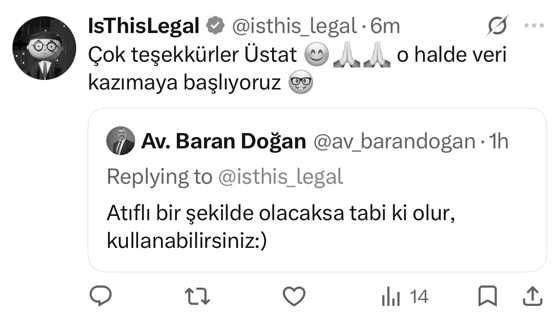

# Kullanım İzni

Bu arşivde yer alan yazıların tüm hakları **Av. Baran Doğan**'a aittir.

## İznin içeriği

1 Kasım 2026 tarihinde X (Twitter) platformunda:

- **@isthis_legal**, yazıların atıflı şekilde açık bir repoda toplanarak yapay zekâ ile kullanılabilir hâle getirilmesi için yazarın rızasını talep etmiş ve kullanımın **ticari olmayacağını** beyan etmiştir.
- **Av. Baran Doğan (@av_barandogan)**, talebe verdiği yanıtta kullanımın **atıflı olması şartıyla** izin vermiştir.

*Av. Baran Doğan: "Atıflı bir şekilde olacaksa tabi ki olur, kullanabilirsiniz:)"*

## Kullanım koşulları

Bu arşivi kullanan herkesin aşağıdaki koşullara uyması rica olunur:

1. **Atıf:** Her kullanımda yazarın adı (Av. Baran Doğan) ve ilgili yazının orijinal bağlantısı belirtilmelidir.
2. **Ticari olmayan kullanım:** Metinler ticari amaçla kullanılmamalı, satılmamalı veya ücretli bir ürünün içeriğine dahil edilmemelidir.
3. **Bütünlük:** Yazara ait olmayan görüşler, yazarın görüşüymüş gibi sunulmamalıdır.
4. **Geri çekme:** Yazarın talebi hâlinde içerik derhâl kaldırılacaktır.

## Kaldırma talebi

Yazar veya temsilcisi, X üzerinden @isthis_legal hesabına ya da bu repoda bir *issue* açarak içeriğin tamamının veya bir kısmının kaldırılmasını talep edebilir.
